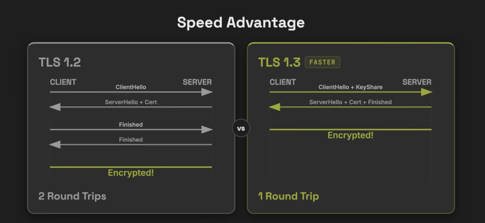

# Inception

## Docker Images

is a read-only template that contains everything needed to create and run a container.

It can contain:
- operation systems
- config files
- commands needed to start the service

Docker Image → creates → Docker Container

first time when you run the name image :
```
docker run busybox echo hello world
```

- busybox: is name of image

the output expected in first time is:


## Docker Container

is an isolated environment created from a Docker image where a service or application runs.

and must be created from an image

*~but if we don't creat the image first~*

- Docker can pull it from a registry automatically:
```
docker run nginx
```

```
Is nginx image local?
       ↓
     No
       ↓
Pull image
       ↓
Create container
       ↓
Start container
```

### what is the diff between cotainer and images:
- image:
    -  is a Template
    - read only
- container is a copy works from the image and you can modify it

```
        Docker Image
        "nginx"
             │
      ┌──────┼──────┐
      ↓      ↓      ↓
 Container Container Container
    #1        #2       #3
```

## Docker Layer:
Every significant instruction in a Dockerfile can result in a layer in the image.

An image = a stack of layers.
```
Dockerfile
    │
    ├── FROM debian
    │       ↓
    │    Layer 1
    │
    ├── RUN apt update
    │       ↓
    │    Layer 2
    │
    ├── RUN apt install nginx
    │       ↓
    │    Layer 3
    │
    └── COPY nginx.conf ...
            ↓
         Layer 4
```
Why docker use layer:
- The primary reason is reusability and the saving of space and time.
- Layers also help with the build cache.

When you run a container from an image, Docker adds a writable layer specific to the container on top of the read-only image layers.

Therefore:

Image
→ A set of read-only layers

Container
→ Image layers + writable container layer


## DockerFile
a plain text configuration file that contains a sequential script of instructions used to automatically build a Docker image

```
Dockerfile
    ↓
docker build
    ↓
Docker Image
    ↓
docker run
    ↓
Container
```

example :
```
FROM debian:13

RUN apt update
RUN apt install -y nginx

COPY nginx.conf /etc/nginx/nginx.conf

CMD ["nginx", "-g", "daemon off;"]
```

Core Dockerfile instaructions:
- FROM: Sets the base image (e.g., Ubuntu, Python, Node.js) that your image will build upon. Every valid Dockerfile must start with this
- RUN : Execute a command during the build process to install packages or setup the encironment (ex, apt-get install ...)
- COPY :


- ENTRYPOINT: The container's "fixed starting point" is the command or program that Docker is forced to execute as soon as the container starts, and which the user cannot simply override.

- CMD: Specifies the default coommand that executes only when the container actively start up. there can only be one effective cmd per dockerfile, The user can easily override 

       The Formula: ENTRYPOINT + CMD = Full Command

```
RUN → During image build
ENTRYPOINT and CMD → When running the container
```

Instructions that modify the filesystem typically produce layers.

```
        IMAGE
┌────────────────────┐
│ COPY nginx.conf     │ ← Layer
├────────────────────┤
│ install nginx       │ ← Layer
├────────────────────┤
│ apt update          │ ← Layer
├────────────────────┤
│ Debian              │ ← Base Layer
└────────────────────┘
```

This links directly to the topic of Images and Layers.

[!NOW BUILD IMAGE FORM DOCKERFILE]

```
docker build -t my-nginx .

(docker build    → Build the image)
(-t my-nginx     → Image name)
(. → Use the current directory as the build context)
```
then execute RUN command ,These commands are executed during the image build.
and save the image = my-ngnix

you can see it from 
```
docker images
```

then you can make container from the image you build:

```
docker run -t my-nginx
```

## Docker Network
A Docker network is like a network within Docker that allows containers to communicate with each other.

ِAll containers has an IP Adress inside the Network, However, do not rely on these IPs manually, because Docker can change them.

### 1. The default Bridge
the Default bridge is the standard network automatically assigned to containers if no other network is specified.

__contact__ : The bridge provides DHCP services, assigning containers IPs in  a private range (typically 172.17.0.x) containers can communicate with each other and the internet via NAT (Network Address Translation )

**Limitations:** This network does not provide automatic DNS resolution between containers (they must be contacted by IP)

### 2. User-Defined Bridge
Docker recommends the use of User-defined bridges over the default bridge for production environments

**Key Benefits:**
* **Isolation:** Provides a dedicated segment for specific workloads, preventing containers on different bridges from communicating.
* **Automatic DNS:** Unlike the default bridge, user-defined bridges allow containers to ping or connect to one another using their container names rather than volatile IP addresses.


### 3. Host Neetworking
- sharing the host’s IP address and ports directly.

- t simplifies connectivity as no ports need to be exposed, but it offers zero network isolation between the container and the host.

### 4\. None Network

The "None" network provides maximum security through total network isolation.

* **Configuration:** Containers assigned to this network have no external network interface, possessing only a loopback interface (`127.0.0.1`).
* **Use Case:** Ideal for highly secure workloads that require no network connectivity whatsoever.
#### How to create Network

```
docker network create (name)
```

#### You can see the available networks
```
docker network ls 
```

#### Create an contatiner and but it in network
```
docker run -d --name ngnix --netwrok inception ngnix

docker    run    -d    --name nginx    --network inception    nginx
  │         │     │          │                  │                │
  │         │     │          │                  │                └─ Image
  │         │     │          │                  └─ Network
  │         │     │          └─ Container name
  │         │     └─ Detached mode run the container in backgroand 
  │         └─ Create + start container
  └─ Docker
```

## Docker-compose
Docker Compose is a tool that allows you to define and run multiple containers together as a single application, rather than running each container with separate `docker run` commands.


## NGINX

NGINX is open-source software primarily used as a 1.web server; it can also function as a 2.reverse proxy, 3.load balancer, and more.

### 1.Web server
NGINX can receive a request and serve files directly:
```
Browser
   |
   | GET /index.html
   v
 NGINX
   |
   v
index.html
```
NGINX can send it to the browser.

### 2.Forward proxy
*It stands before the users.*

It is used to control how user devices access the internet, or to hide their IP address from the websites they connect to, like (VPN)


### 3. Reverce proxy
*It stands before the services*
NGINX receives a request and then forwards it to another application.

It receives user requests from outside via HTTPS, then passes them to WordPress within the Docker network.

and this what do proxy 

A proxy is basically a middleman
```
Browser
   |
   v
 NGINX(recerse proxy)
   |
   v
Application
```

What are its primary functions
- **Security**: hiding the details and addresses of internal servers, while allowing for the implementation of security policies
- **Load balancing**: distributing(توزيع) requests across multiple servers to alleviate pressure
- **SSL/TLS termination** : handiling HTTPS and certificates then forwarding the requests to the internal server
- **Routing** : directing each request to the appropriate(مناسب) service based on the domain or path
- **caching** : storing certain responses to reduce load and improve response speed
- **Payload Compression** : Compresses outgoing responses using algorithms such as `gzip` or `Brotli`, reducing bandwidth usage and response latency without consuming backend CPU cycles.
### 4. load balancing

is a specific role where the middleman distributes requests across multiple servers:

```
             Load Balancer
                  |
        +---------+---------+
        |         |         |
      Server 1  Server 2  Server 3

Request 1 → Server 1
Request 2 → Server 2
Request 3 → Server 3
Request 4 → Server 1
```

A load balancer can function as a reverse proxy, but a reverse proxy does not necessarily perform load balancing.
```
Proxy
  |
  +── Can forward requests to one server
  |
  +── Can forward requests to multiple servers
       ↓
     Load Balancing
```

### encryption in NGNIX

#### Transport Layer Security (TLS)
the protocol underpinning HTTPS—is widely associated with data encryption

and

TLS solves three different problens at once:
- Confidentiality: can someone read the data?
- Integrit: can someone modify the data
- Authentication: Is the sercer you are talking to actually who it claims to be ?

TLS addresses the distinct(المتميز) performance and security trade-offs of symmetric and asymmetric encryption by combining both into a single hybrid model.



## Wordpress

A program that allows you to build and manage a website

Wordpress is a collection of PHP files and other files.

Wordpress write in PHP and the web don't understand PHP 

Here it comes **PHP-FPM:**
**FPM: FastCGI process Manager**
- It is responsible for exevuting PHP
```
Browser
   │
   │ HTTP/HTTPS
   ↓
NGINX
   │
   │ FastCGI
   ↓
PHP-FPM
   │
   │ executes PHP
   ↓
WordPress
```
**FastCGI**: IT is a protocol or interface used by programs to communicate with other programs in order to process requests

## MariaDB

Database Management System (DBMS)

- **MariaDB**: the system that manages databases
- **Database**:  The dataset manages by the system 

###  MariaDB server
 The process that runs and waits for connections from other programs
```
WordPress/PHP
      │
      │ connection
      ▼
MariaDB Server
      │
      ▼
wordpress database
```
the default port for MariaDB/MySQL: **3306**
```
WordPress Container ─── 3306 ───> DB Container
```
مفهوم pid1 and tail and sleep infinity daemons
## popular commands in docker:

### make container and go inside it :
```
docker run -it --name my_container debian
```
- -it  i = interactive :you can write inputs t=TTY:active like the terminal 
- (optional) --name: the container name
- hamza = image name
when we run this command we in the container

### how ca I know how many packages I have in container
```
dpkg -l | wc -l
```
- dpkg -l : list of all packages
- wc -l : filter and count the lines

### exit to my contation
```
exit
```

### show the logs in the container
used to retrieve and view the output streams (STDOUT and STDERR) generated by a specific running or stopped container
```
docker logs (name of the container)
```

